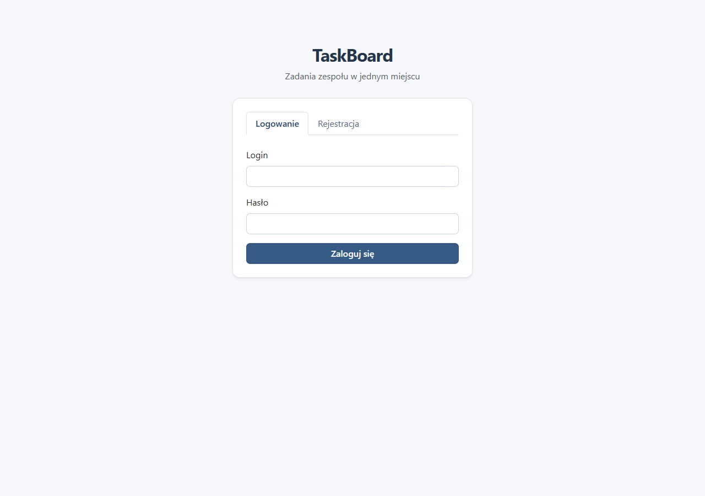
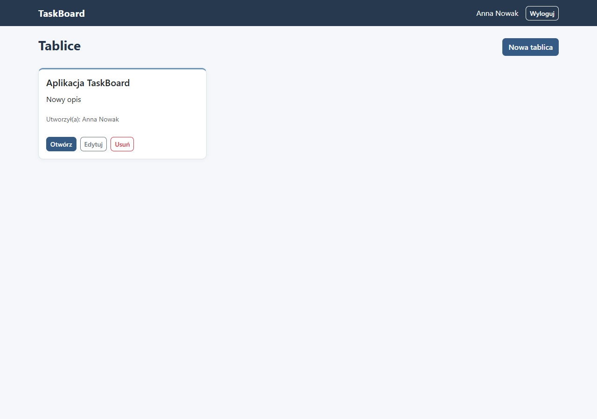
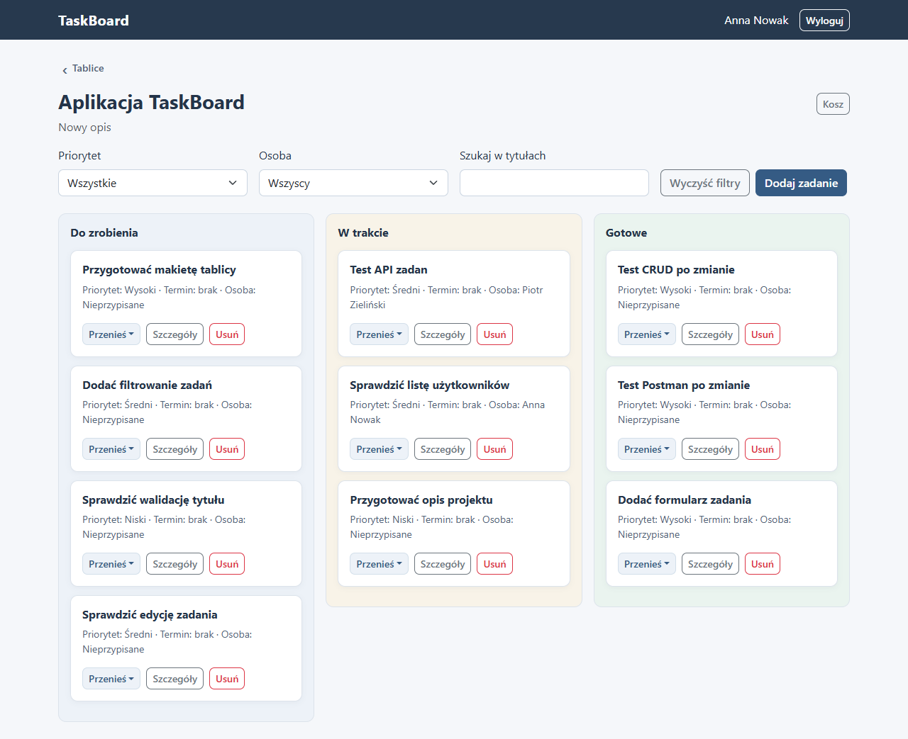

# TaskBoard

TaskBoard to aplikacja do zarządzania zadaniami zespołu. Po zalogowaniu można tworzyć tablice, przypisywać zadania osobom i przenosić je między kolumnami: Do zrobienia, W trakcie i Gotowe.

## Możliwości

- Rejestracja, logowanie i wylogowanie.
- Dodawanie, edycja i usuwanie tablic oraz zadań.
- Zmiana statusu przyciskiem lub przeciągnięciem karty.
- Łączone filtry po priorytecie, osobie i fragmencie tytułu.
- Kosz z przywracaniem zadań do poprzedniej kolumny.

Z kosza można zgłosić zadanie do ostatecznego usunięcia. Zgłoszenia rozpatruje administrator strony w osobnym panelu. Zwykłe konto aplikacji nadal nie ma prawa DELETE. Odrzucenie pozostawia zadanie w koszu, a przywrócenie anuluje zgłoszenie.

### Konfiguracja panelu administratora

W istniejącej bazie wykonaj jako administrator kolejno `database/migrations/003-deletion-review.sql` i `database/migrations/004-viewer-role.sql`. Świeże pliki SQL zawierają już nowe kolumny i role.

Administrator strony i administrator MySQL to dwa różne konta. Aby utworzyć administratora strony na nowej instalacji, zarejestruj osobne konto przez formularz, a następnie jako administrator bazy ustaw jego rolę (podstaw własny login):

```sql
UPDATE users SET role = 'admin' WHERE login = 'login_administratora';
```

Rejestracja zawsze tworzy obserwatora (`viewer`) z prawem wyłącznie do podglądu. Edytor (`editor`) może tworzyć, edytować, przenosić, usuwać miękko i przywracać zadania oraz zgłaszać je administratorowi. Administrator (`admin`) ma również dostęp do rozpatrywania zgłoszeń. Pięć kont demonstracyjnych z materiałów ma rolę edytora.

Rolę edytora można nadać jako administrator bazy:

```sql
UPDATE users SET role = 'editor' WHERE login = 'login_edytora';
```

 Zmiany roli nie można wykonać przez formularz ani podanie `role` w JSON. Panel znajduje się pod `/admin.html`; link pojawia się w nagłówku administratora.

Do zatwierdzania usunięć uzupełnij lokalny `.env`:

```dotenv
ADMIN_DB_USER=taskboard_admin
ADMIN_DB_PASSWORD=haslo_konta_mysql_taskboard_admin
```

To hasło konta **MySQL**, nie hasło logowania na stronie. Konto bazy utworzone przez `database/konta.sql` ma już DELETE; nie rozszerzamy praw `taskboard_app`. Dane administracyjne są używane wyłącznie po sprawdzeniu roli administratora przy ostatecznym usunięciu. Bez konfiguracji żądanie zatwierdzenia zwraca 503, a zgłoszenie pozostaje do rozpatrzenia.

## Technologie i środowisko

Frontend: HTML, CSS, JavaScript i Bootstrap 5.3.3. Backend: Node.js, Express, express-session i bcryptjs. Dane: MariaDB z pakietu XAMPP i mysql2.

Potrzebne są Git, Node.js z npm, XAMPP z MariaDB oraz przeglądarka. Bootstrap ładowany jest z CDN, więc do pobrania jego plików potrzebny jest internet. Frontend obsługuje serwer Node.js; Apache jest przydatny do phpMyAdmin.

## Uruchomienie na Windows

1. Sklonuj projekt i przejdź do katalogu:

   ```powershell
   git clone https://github.com/AZAZAouh/taskboard-Stanilsav-Pravdyvtsev.git
   cd taskboard-Stanilsav-Pravdyvtsev
   ```

2. Włącz MySQL i Apache w XAMPP. Otwórz phpMyAdmin, utwórz bazę `taskboard` z kodowaniem `utf8mb4_polish_ci` i zaimportuj `database/backup/taskboard-2026-11-20.sql`. Kopia zawiera strukturę i konta testowe aplikacji. Alternatywny `database/taskboard.sql` sam tworzy bazę, ale na początku usuwa poprzednią bazę o tej nazwie.

3. W lokalnej kopii `database/konta.sql` zastąp hasła `ZMIEŃ_HASŁO_...` własnymi i wykonaj skrypt jako administrator bazy. Konto `taskboard_app` służy serwerowi, `taskboard_admin` ma szersze prawa administracyjne, a `taskboard_report` tylko odczyt. Własnych haseł nie zapisuj w commicie.

4. Skopiuj wzór konfiguracji do pliku `.env` w głównym katalogu projektu:

   ```powershell
   Copy-Item .env.example .env
   ```

   Uzupełnij `DB_HOST` (np. `127.0.0.1`), `DB_USER` (`taskboard_app`), `DB_PASSWORD` (hasło ustawione w kroku 3), `DB_NAME` (`taskboard`) i `SESSION_SECRET` (własny długi losowy tekst). Nie zostawiaj pustego sekretu sesji. Plik `.env` jest ignorowany przez Git.

5. Zainstaluj biblioteki i uruchom serwer:

   ```powershell
   cd backend
   npm.cmd ci
   npm.cmd start
   ```

6. Otwórz [stronę logowania](http://127.0.0.1:3000/login.html). Serwer działa też pod `http://127.0.0.1:3000`, a `/api/health` zwraca `{"ok":true}`. Terminal serwera musi pozostać otwarty. Po zmianach backendu lub `.env` zatrzymaj serwer przez Ctrl+C i uruchom ponownie.

Na Linux i macOS użyj `npm ci` i `npm start` zamiast poleceń z `.cmd`.

## Konta testowe aplikacji

| Login | Hasło |
| --- | --- |
| `anna.nowak` | `Test1234!` |
| `jan.kowalski` | `Test1234!` |
| `ola.wisniewska` | `Test1234!` |
| `piotr.zielinski` | `Test1234!` |
| `kasia.lewandowska` | `Test1234!` |

Są to konta z dołączonej bazy testowej. Można też utworzyć własne konto przez zakładkę Rejestracja. Sesje są przechowywane w pamięci serwera — po jego restarcie trzeba zalogować się ponownie.

## Struktura projektu

| Katalog | Zawartość |
| --- | --- |
| `frontend/` | Strony logowania, listy tablic i zadań, style oraz JavaScript |
| `backend/` | Serwer, sesje, walidacja i trasy API |
| `database/` | Struktura bazy, kopia zapasowa, konta i zapytania SQL |
| `docs/` | Opis danych, API, testy, raporty i zrzuty ekranu |
| `docs/zadania/` | Treści zadań z praktyk |
| `materialy/` | Makiety i materiały od prowadzącego |

## Dokumentacja i sprawdzenie

- [API i przykładowy JSON](docs/api.md)
- [Przypadki testowe i wyniki](docs/testy.md)
- [Opis danych i ERD](docs/dane.md)
- [Zadanie TB-3](docs/zadania/TB-3.md)

Przeprowadzono testy w lokalnym Chrome, w tym filtry, zmianę statusu, kosz i widok 390 px. Lighthouse Accessibility: 100 / 100 / 96 / 100. HTML sprawdzono lokalnym Nu Html Checker bez błędów. Dokładny zakres i ograniczenia są w raporcie testów. Uruchomienie z czystego klonu sprawdzono na oddzielnej bazie: import SQL, konfiguracja, npm ci, logowanie i obsługa zgłoszenia usunięcia zakończyły się poprawnie.

## Zrzuty ekranu

### Logowanie



### Tablice



### Zadania



[Widok tablicy na telefonie](docs/screenshots/board-mobile.png)

## Autor

Stanislav Pravdyvtsev
