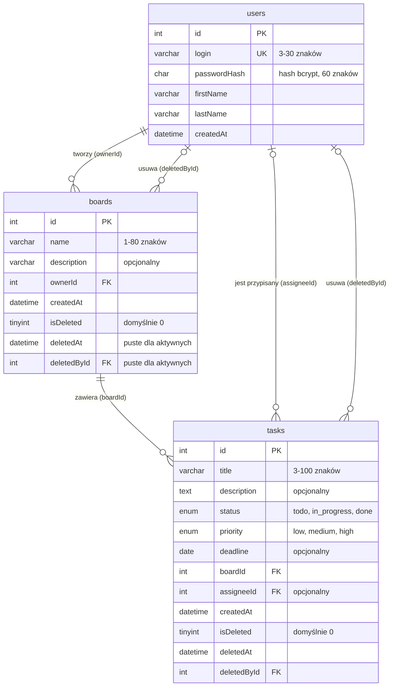

# Opis danych TaskBoard

## Co aplikacja przechowuje

TaskBoard służy do porządkowania zadań na tablicach. Poniżej opisałem dane potrzebne do logowania, tworzenia tablic i zapisywania zadań. Przykłady dotyczą jednej tablicy i pracującej na niej Anny Nowak.

### Użytkownik

Użytkownik loguje się przez login i hasło. Po zalogowaniu w nagłówku widać jego imię i nazwisko.

| Informacja | Przykład |
| --- | --- |
| Identyfikator (`id`) | `1` |
| Login (`login`) | `anna.nowak` |
| Hash hasła (`passwordHash`) | hash bcrypt hasła, np. `$2b$12$...` |
| Imię (`firstName`) | Anna |
| Nazwisko (`lastName`) | Nowak |
| Data utworzenia (`createdAt`) | `2026-10-27 10:00:00` |

W bazie zapisujemy hash hasła, czyli wynik jego przetworzenia, a nie samo hasło. W tabeli podałem tylko początek przykładowego hasha.

### Tablica

Tablica zbiera zadania dotyczące jednego projektu. Na liście tablic widać jej nazwę, opis, twórcę i liczbę aktywnych zadań. Tę liczbę można policzyć z zadań należących do tablicy, więc nie dodaję dla niej osobnego pola.

| Informacja | Przykład |
| --- | --- |
| Identyfikator (`id`) | `2` |
| Nazwa (`name`) | Aplikacja TaskBoard |
| Opcjonalny opis (`description`) | Zadania zespołu przy budowie aplikacji |
| Identyfikator twórcy (`ownerId`) | `1` |
| Data utworzenia (`createdAt`) | `2026-10-27 10:30:00` |
| Czy usunięta (`isDeleted`) | `0` |
| Data usunięcia (`deletedAt`) | `null` |
| Identyfikator osoby usuwającej (`deletedById`) | `null` |

### Zadanie

Zadanie to konkretna rzecz do zrobienia. Na karcie widać między innymi tytuł, priorytet, termin i przypisaną osobę. Opis można uzupełnić w oknie szczegółów.

| Informacja | Przykład |
| --- | --- |
| Identyfikator (`id`) | `15` |
| Tytuł (`title`) | Przygotować prezentację projektu |
| Opcjonalny opis (`description`) | Zebrać najważniejsze informacje o projekcie |
| Status (`status`) | `in_progress` |
| Priorytet (`priority`) | `high` |
| Opcjonalny termin (`deadline`) | `2026-12-15` |
| Identyfikator tablicy (`boardId`) | `2` |
| Opcjonalny identyfikator wykonawcy (`assigneeId`) | `1` |
| Data utworzenia (`createdAt`) | `2026-10-27 11:00:00` |
| Czy usunięte (`isDeleted`) | `0` |
| Data usunięcia (`deletedAt`) | `null` |
| Identyfikator osoby usuwającej (`deletedById`) | `null` |

Status określa, w której kolumnie tablicy znajduje się zadanie:

- `todo` — Do zrobienia,
- `in_progress` — W trakcie,
- `done` — Gotowe.

Priorytet może być niski (`low`), średni (`medium`) albo wysoki (`high`). Zadanie nie musi mieć opisu, terminu ani przypisanej osoby. Wartość `null` w przykładach oznacza brak wartości.

## Powiązania

Jeden użytkownik może utworzyć wiele tablic. Każda tablica ma jednego twórcę, którego identyfikator zapisujemy w `ownerId`.

Na jednej tablicy może być wiele zadań, ale każde zadanie należy tylko do jednej tablicy. Pole `boardId` mówi, do której. Nowa tablica może być jeszcze pusta.

Użytkownik może mieć przypisanych kilka zadań. Jedno zadanie ma najwyżej jedną przypisaną osobę, wskazaną przez `assigneeId`. Jeśli nikogo jeszcze nie przypisano, to pole ma wartość `null`.

Po usunięciu tablica lub zadanie znika z widoku, ale zostaje w bazie. Wtedy `isDeleted` zmienia się na `1`, a w `deletedAt` i `deletedById` zapisujemy datę usunięcia oraz identyfikator osoby, która usunęła rekord. To tak zwane miękkie usuwanie (soft delete). Dla aktywnych rekordów `isDeleted` wynosi `0`, a oba pola dotyczące usunięcia mają wartość `null`.

## Przykład zadania w JSON

W tym przykładzie Anna Nowak (`id = 1`) przygotowuje prezentację na tablicy „Aplikacja TaskBoard” (`id = 2`). Zadanie jest w trakcie i ma wysoki priorytet.

```json
{
  "id": 15,
  "title": "Przygotować prezentację projektu",
  "description": "Zebrać najważniejsze informacje o projekcie",
  "status": "in_progress",
  "priority": "high",
  "deadline": "2026-12-15",
  "boardId": 2,
  "assigneeId": 1,
  "createdAt": "2026-10-27 11:00:00",
  "isDeleted": 0,
  "deletedAt": null,
  "deletedById": null
}
```

## Wstępny diagram ERD

Poniżej są trzy tabele i powiązania między nimi. Nazwy pól i typy sprawdziłem z [diagramem w materiałach](../materialy/erd.md).

`PK` to klucz główny, który rozpoznaje konkretny rekord. `FK` to klucz obcy, czyli odwołanie do rekordu w innej tabeli. `UK` oznacza wartość unikalną — dwie osoby nie mogą mieć tego samego loginu.


